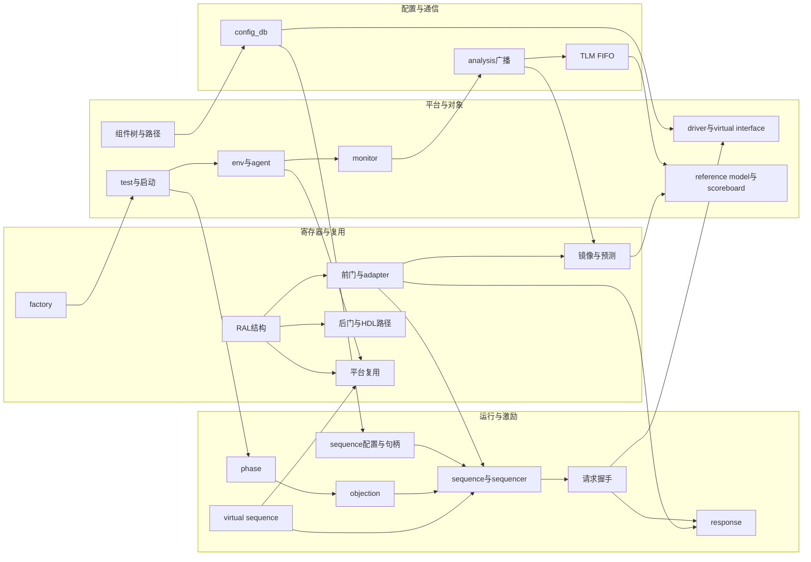

# UVM 知识网络

按概念组织的独立复习卡片。每篇包含核心解释、机制、局部示例、易错点、有理由的双向关联，以及返回原章节和已有面试题的链接。长代码和详细推导保留在章节笔记中。

从具体问题进入，沿“关联知识”跳到相邻概念，再回原文核对细节。编号用于索引，不要求顺序阅读。

> **版本与示例约定**：依据本仓库《UVM 实战》第1～9章和现有八股整理，教材主要采用 UVM 1.1d。starting_phase、旧式配置接口、sequence library 等需核对项目版本。代码均为带上下文说明的局部片段，用户类型、接口、驱动 task 和完成标志由平台提供。原文5.1.5对 super.phase 的内容仍标注待复习，此处保留该状态。

## 关系总图

箭头表示值得继续追问的机制联系，不统一代表继承、调用或数据流，具体含义见卡片说明。图展示主要跨主题关系，完整概念和普通链接见下方。

## 三条阅读路线

每一站均可直接点击，不依赖图表渲染；右侧局部图谱也会展示卡片之间的关联。

### 平台搭建

从角色分工走到能运行、检查并正确结束的最小环境。

[[知识卡片/UVM/01_UVM方法学与平台全貌|UVM方法学与平台全貌]] → [[知识卡片/UVM/02_object与component|object与component]] → [[知识卡片/UVM/06_env与agent|env与agent]] → [[知识卡片/UVM/03_组件树与实例路径|组件树与实例路径]] → [[知识卡片/UVM/10_config_db|config_db]] → [[知识卡片/UVM/07_driver与virtual_interface|driver与virtual_interface]] → [[知识卡片/UVM/08_monitor|monitor]] → [[知识卡片/UVM/12_TLM与port_export_imp|TLM与port_export_imp]] → [[知识卡片/UVM/13_analysis广播|analysis广播]] → [[知识卡片/UVM/14_TLM_FIFO|TLM_FIFO]] → [[知识卡片/UVM/09_reference_model与scoreboard|reference_model与scoreboard]] → [[知识卡片/UVM/05_test与启动流程|test与启动流程]] → [[知识卡片/UVM/18_sequence与sequencer|sequence与sequencer]] → [[知识卡片/UVM/19_请求握手|请求握手]] → [[知识卡片/UVM/16_objection|objection]]

### 机制理解

串起创建、配置、阶段、请求、应答与寄存器访问。

[[知识卡片/UVM/02_object与component|object与component]] → [[知识卡片/UVM/03_组件树与实例路径|组件树与实例路径]] → [[知识卡片/UVM/31_factory注册_创建与override|factory注册_创建与override]] → [[知识卡片/UVM/10_config_db|config_db]] → [[知识卡片/UVM/15_phase|phase]] → [[知识卡片/UVM/16_objection|objection]] → [[知识卡片/UVM/18_sequence与sequencer|sequence与sequencer]] → [[知识卡片/UVM/21_sequence生命周期与宏|sequence生命周期与宏]] → [[知识卡片/UVM/20_仲裁与lock_grab|仲裁与lock_grab]] → [[知识卡片/UVM/19_请求握手|请求握手]] → [[知识卡片/UVM/24_response|response]] → [[知识卡片/UVM/23_sequence配置与sequencer句柄|sequence配置与sequencer句柄]] → [[知识卡片/UVM/22_virtual_sequence|virtual_sequence]] → [[知识卡片/UVM/26_RAL模型结构|RAL模型结构]] → [[知识卡片/UVM/27_前门_adapter与总线链路|前门_adapter与总线链路]] → [[知识卡片/UVM/29_期望值_镜像值与预测|期望值_镜像值与预测]] → [[知识卡片/UVM/28_后门与HDL路径|后门与HDL路径]] → [[知识卡片/UVM/17_domain与phase跳转|domain与phase跳转]]

### 面试复习

围绕概念区别、完整链路和故障定位组织回答，各卡片底部直达现有问题。

[[知识卡片/UVM/01_UVM方法学与平台全貌|UVM方法学与平台全貌]] → [[知识卡片/UVM/02_object与component|object与component]] → [[知识卡片/UVM/03_组件树与实例路径|组件树与实例路径]] → [[知识卡片/UVM/10_config_db|config_db]] → [[知识卡片/UVM/11_report日志机制|report日志机制]] → [[知识卡片/UVM/12_TLM与port_export_imp|TLM与port_export_imp]] → [[知识卡片/UVM/14_TLM_FIFO|TLM_FIFO]] → [[知识卡片/UVM/15_phase|phase]] → [[知识卡片/UVM/16_objection|objection]] → [[知识卡片/UVM/18_sequence与sequencer|sequence与sequencer]] → [[知识卡片/UVM/19_请求握手|请求握手]] → [[知识卡片/UVM/21_sequence生命周期与宏|sequence生命周期与宏]] → [[知识卡片/UVM/23_sequence配置与sequencer句柄|sequence配置与sequencer句柄]] → [[知识卡片/UVM/22_virtual_sequence|virtual_sequence]] → [[知识卡片/UVM/24_response|response]] → [[知识卡片/UVM/31_factory注册_创建与override|factory注册_创建与override]] → [[知识卡片/UVM/32_callback|callback]] → [[知识卡片/UVM/33_参数化与平台复用|参数化与平台复用]]

## 概念索引

### 平台与对象

| 卡片 | 复习时回答的问题 |
|---|---|
| [UVM方法学与平台全貌](01_UVM方法学与平台全貌.md) | 平台如何形成检查闭环？ |
| [object与component](02_object与component.md) | 谁挂组件树，谁需显式启动？ |
| [组件树与实例路径](03_组件树与实例路径.md) | 路径与变量名、HDL 层次有何区别？ |
| [transaction与字段操作](04_transaction与字段操作.md) | 句柄共享和字段操作如何配合？ |
| [test与启动流程](05_test与启动流程.md) | run_test 怎样建平台并启动场景？ |
| [env与agent](06_env与agent.md) | active/passive 如何封装协议能力？ |
| [driver与virtual_interface](07_driver与virtual_interface.md) | 事务如何变时序，vif 如何传入？ |
| [monitor](08_monitor.md) | 为什么检查依赖真实观测？ |
| [reference_model与scoreboard](09_reference_model与scoreboard.md) | 如何匹配比较并发现遗漏？ |

### 配置与通信

| 卡片 | 复习时回答的问题 |
|---|---|
| [config_db](10_config_db.md) | 配置如何匹配、覆盖和共享？ |
| [report日志机制](11_report日志机制.md) | 严重性与详细级别有何区别？ |
| [TLM与port_export_imp](12_TLM与port_export_imp.md) | 谁调用、转接与实现？ |
| [analysis广播](13_analysis广播.md) | 如何广播，为什么不能耗时或改共享对象？ |
| [TLM_FIFO](14_TLM_FIFO.md) | 如何缓存，条目是副本吗？ |

### 运行与激励

| 卡片 | 复习时回答的问题 |
|---|---|
| [phase](15_phase.md) | run 与 main 如何运行？ |
| [objection](16_objection.md) | 谁保持场景存活，何时能结束？ |
| [domain与phase跳转](17_domain与phase跳转.md) | 跳回 reset 还要清理什么？ |
| [sequence与sequencer](18_sequence与sequencer.md) | 启动 sequence 与发送 item 有何区别？ |
| [请求握手](19_请求握手.md) | 授权、提交、取请求和完成如何配对？ |
| [仲裁与lock_grab](20_仲裁与lock_grab.md) | 怎样仲裁和独占，能否抢断事务？ |
| [sequence生命周期与宏](21_sequence生命周期与宏.md) | 宏封装什么，哪些回调可能跳过？ |
| [virtual_sequence](22_virtual_sequence.md) | 多接口怎样并发与同步？ |
| [sequence配置与sequencer句柄](23_sequence配置与sequencer句柄.md) | sequence 如何取配置和具体句柄？ |
| [response](24_response.md) | 谁产生响应，如何路由消费？ |
| [sequence_library](25_sequence_library.md) | 候选场景如何组合复现？ |

### 寄存器与复用

| 卡片 | 复习时回答的问题 |
|---|---|
| [RAL模型结构](26_RAL模型结构.md) | field/reg/block/map 表达什么？ |
| [前门_adapter与总线链路](27_前门_adapter与总线链路.md) | reg.read 怎样到引脚再返回？ |
| [后门与HDL路径](28_后门与HDL路径.md) | HDL path 怎样拼接，后门 API 如何区分？ |
| [期望值_镜像值与预测](29_期望值_镜像值与预测.md) | 三种值为何不同，如何预测？ |
| [寄存器内建测试与常用API](30_寄存器内建测试与常用API.md) | 通用测试有什么前提与限制？ |
| [factory注册_创建与override](31_factory注册_创建与override.md) | 注册、create、override 如何配合？ |
| [callback](32_callback.md) | 如何在组件钩子插入行为？ |
| [参数化与平台复用](33_参数化与平台复用.md) | block 到 chip 复用什么、重组什么？ |

## 按问题进入网络

- **driver收不到激励**：[[知识卡片/UVM/18_sequence与sequencer|sequence与sequencer]] → [[知识卡片/UVM/19_请求握手|请求握手]] → [[知识卡片/UVM/20_仲裁与lock_grab|仲裁与lock_grab]] → [[知识卡片/UVM/15_phase|phase]]。
- **vif或配置取不到**：[[知识卡片/UVM/03_组件树与实例路径|组件树与实例路径]] → [[知识卡片/UVM/10_config_db|config_db]] → [[知识卡片/UVM/07_driver与virtual_interface|driver与virtual_interface]] → [[知识卡片/UVM/23_sequence配置与sequencer句柄|sequence配置与sequencer句柄]]。
- **零时间结束或一直不退出**：[[知识卡片/UVM/15_phase|phase]] → [[知识卡片/UVM/16_objection|objection]] → [[知识卡片/UVM/09_reference_model与scoreboard|reference_model与scoreboard]]。
- **scoreboard数据被覆盖或比对错位**：[[知识卡片/UVM/04_transaction与字段操作|transaction与字段操作]] → [[知识卡片/UVM/08_monitor|monitor]] → [[知识卡片/UVM/13_analysis广播|analysis广播]] → [[知识卡片/UVM/14_TLM_FIFO|TLM_FIFO]] → [[知识卡片/UVM/09_reference_model与scoreboard|reference_model与scoreboard]]。
- **RAL read卡住或结果错误**：[[知识卡片/UVM/26_RAL模型结构|RAL模型结构]] → [[知识卡片/UVM/27_前门_adapter与总线链路|前门_adapter与总线链路]] → [[知识卡片/UVM/18_sequence与sequencer|sequence与sequencer]] → [[知识卡片/UVM/19_请求握手|请求握手]] → [[知识卡片/UVM/07_driver与virtual_interface|driver与virtual_interface]] → [[知识卡片/UVM/24_response|response]]。
- **镜像不一致或外部master写入未被跟踪**：[[知识卡片/UVM/08_monitor|monitor]] → [[知识卡片/UVM/13_analysis广播|analysis广播]] → [[知识卡片/UVM/29_期望值_镜像值与预测|期望值_镜像值与预测]] → [[知识卡片/UVM/27_前门_adapter与总线链路|前门_adapter与总线链路]]。
- **复位后旧事务污染新场景**：[[知识卡片/UVM/17_domain与phase跳转|domain与phase跳转]] → [[知识卡片/UVM/14_TLM_FIFO|TLM_FIFO]] → [[知识卡片/UVM/20_仲裁与lock_grab|仲裁与lock_grab]] → [[知识卡片/UVM/29_期望值_镜像值与预测|期望值_镜像值与预测]]。
- **需要改行为但不确定机制**：[[知识卡片/UVM/10_config_db|config_db]] → [[知识卡片/UVM/18_sequence与sequencer|sequence与sequencer]] → [[知识卡片/UVM/31_factory注册_创建与override|factory注册_创建与override]] → [[知识卡片/UVM/32_callback|callback]] → [[知识卡片/UVM/33_参数化与平台复用|参数化与平台复用]]。

## 回到章节与面试题

- [[学习笔记/UVM/01-UVM概念与验证方法学|第 1 章]]：[[知识卡片/UVM/01_UVM方法学与平台全貌|UVM方法学与平台全貌]]。
- [[学习笔记/UVM/02-验证平台搭建与测试用例|第 2 章]]：[[知识卡片/UVM/01_UVM方法学与平台全貌|UVM方法学与平台全貌]]、[[知识卡片/UVM/04_transaction与字段操作|transaction与字段操作]]、[[知识卡片/UVM/05_test与启动流程|test与启动流程]]、[[知识卡片/UVM/06_env与agent|env与agent]]、[[知识卡片/UVM/07_driver与virtual_interface|driver与virtual_interface]]、[[知识卡片/UVM/08_monitor|monitor]]、[[知识卡片/UVM/09_reference_model与scoreboard|reference_model与scoreboard]]、[[知识卡片/UVM/18_sequence与sequencer|sequence与sequencer]]。
- [[学习笔记/UVM/03-组件层次与config_db配置|第 3 章]]：[[知识卡片/UVM/02_object与component|object与component]]、[[知识卡片/UVM/03_组件树与实例路径|组件树与实例路径]]、[[知识卡片/UVM/04_transaction与字段操作|transaction与字段操作]]、[[知识卡片/UVM/10_config_db|config_db]]、[[知识卡片/UVM/11_report日志机制|report日志机制]]。
- [[学习笔记/UVM/04-TLM通信与端口连接|第 4 章]]：[[知识卡片/UVM/08_monitor|monitor]]、[[知识卡片/UVM/09_reference_model与scoreboard|reference_model与scoreboard]]、[[知识卡片/UVM/12_TLM与port_export_imp|TLM与port_export_imp]]、[[知识卡片/UVM/13_analysis广播|analysis广播]]、[[知识卡片/UVM/14_TLM_FIFO|TLM_FIFO]]。
- [[学习笔记/UVM/05-Phase调度与Objection控制|第 5 章]]：[[知识卡片/UVM/15_phase|phase]]、[[知识卡片/UVM/16_objection|objection]]、[[知识卡片/UVM/17_domain与phase跳转|domain与phase跳转]]。
- [[学习笔记/UVM/06-Sequence激励与Sequencer握手|第 6 章]]：[[知识卡片/UVM/05_test与启动流程|test与启动流程]]、[[知识卡片/UVM/07_driver与virtual_interface|driver与virtual_interface]]、[[知识卡片/UVM/18_sequence与sequencer|sequence与sequencer]]、[[知识卡片/UVM/19_请求握手|请求握手]]、[[知识卡片/UVM/20_仲裁与lock_grab|仲裁与lock_grab]]、[[知识卡片/UVM/21_sequence生命周期与宏|sequence生命周期与宏]]、[[知识卡片/UVM/22_virtual_sequence|virtual_sequence]]、[[知识卡片/UVM/23_sequence配置与sequencer句柄|sequence配置与sequencer句柄]]、[[知识卡片/UVM/24_response|response]]、[[知识卡片/UVM/25_sequence_library|sequence_library]]。
- [[学习笔记/UVM/07-RAL寄存器模型与前后门访问|第 7 章]]：[[知识卡片/UVM/26_RAL模型结构|RAL模型结构]]、[[知识卡片/UVM/27_前门_adapter与总线链路|前门_adapter与总线链路]]、[[知识卡片/UVM/28_后门与HDL路径|后门与HDL路径]]、[[知识卡片/UVM/29_期望值_镜像值与预测|期望值_镜像值与预测]]、[[知识卡片/UVM/30_寄存器内建测试与常用API|寄存器内建测试与常用API]]。
- [[学习笔记/UVM/08-Factory注册与类型覆盖|第 8 章]]：[[知识卡片/UVM/31_factory注册_创建与override|factory注册_创建与override]]。
- [[学习笔记/UVM/09-Callback回调与平台复用|第 9 章]]：[[知识卡片/UVM/06_env与agent|env与agent]]、[[知识卡片/UVM/22_virtual_sequence|virtual_sequence]]、[[知识卡片/UVM/32_callback|callback]]、[[知识卡片/UVM/33_参数化与平台复用|参数化与平台复用]]。
- [[学习笔记/UVM/面试八股|UVM 八股全文]]：现有 Q1～Q30 已映射到相关卡片；没有现成题目的主题不强行补题。

## 来源与章节学习

本栏目根据配套 UVM 章节笔记按概念重新整理，保留其教材版本与待复习提示。原文作者 qingxuanxx，原仓库采用 MIT 许可；详细来源见 [[学习笔记/UVM/index#来源与许可|UVM 章节来源与许可]]，完整许可证见 [MIT 许可证](../../assets/uvm-notes-LICENSE.txt)。

[[知识卡片/index|返回知识卡片]] · [[学习笔记/UVM/index|按章节学习 UVM]]

## 后续维护

- 新卡片加入索引，并补至少一组有理由的双向关系。
- 章节标题或八股题号变化时同步核对出处锚点。
- 新版本结论明确适用背景，未确认内容保留待复习标注。
